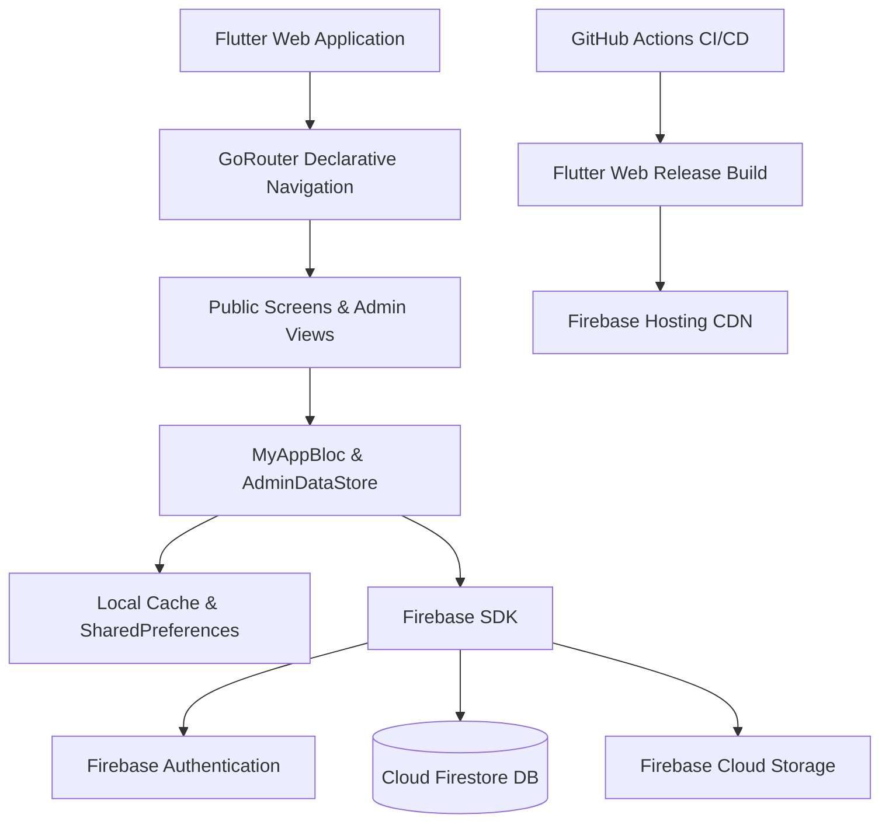

# Shree Pavan Putra Garbi Mandal, Rajkot
### શ્રી પવનપુત્ર ગરબી મંડળ — રાજકોટ
#### *|| જગતી જોગમાયા ||*

[](https://flutter.dev)
[](https://dart.dev)
[](https://firebase.google.com)
[](.github/workflows/deploy.yml)
[](#quality-assurance--linting)
[](lib/core/my_app_color/my_app_colors.dart)

---

## 📖 Overview

**Pavan Putra Garbi Mandal** is Rajkot's premier traditional *Prachin Garbi* and Navratri cultural institution, dedicated to preserving centuries of authentic devotional folk traditions, Mataji's Aradhana, and sacred Dandiya Raas. 

This repository contains the production-grade, bilingual **Flutter Web Application** and comprehensive **Administrative Management Portal (CMS)** engineered for Pavan Putra Garbi Mandal. The platform combines a cultural public portal with a real-time administrative system powered by Firebase Cloud services.

---

## ✨ Key Capabilities & Features

### 🏛️ 1. Public Cultural Showcase
* **Heritage Aesthetic:** Bespoke Heritage theme featuring Heritage Maroon (`#570814`), Heritage Gold (`#C89B3C`), Warm Ivory, and Dark Charcoal, pairing editorial serif typography (*Cormorant Garamond* & *Noto Serif Gujarati*) with modern sans-serif readability.
* **Bilingual Locale Engine:** Native one-click switching between **Gujarati (ગુજરાતી)** and **English**, with complete Unicode rendering and typography tuning.
* **Multi-Year Digital Archive:** Chronological journey through Garbi years, annual themes, historic photo albums, and high-resolution galleries.
* **Devotional Video Showcase & Live Broadcasts:** YouTube video integration, annual highlights, and live stream broadcast banners with responsive mobile layouts.
* **Devotional Offerings & Seva (UPI & QR):** Direct Mandal bank UPI integration with tap-to-copy UPI ID, high-resolution modal QR display, and clear devotional purpose attribution.
* **Mandir Darshan, Aarti & Contact:** Real-time mandir coordinates, daily Aarti timings, one-click WhatsApp messaging, phone links, and an anti-spam protected inquiry form.

### 🛡️ 2. Administrative Management Portal (CMS)
* **Real-Time Live Preview Synchronization:** As admins type in editing forms, changes instantly reflect in adjacent preview cards without manual page reloads.
* **Bilingual Live Preview Switch:** Admins can preview both Gujarati and English renderings simultaneously before publishing.
* **Drag-and-Drop Reordering:** Intuitive reordering handles (`ReorderableListView`) with auto-assigned sequential order for:
  - Committee Members & Trustees
  - Heritage Milestones & Foundation Timeline
  - Core Spiritual Principles
  - Troupe Singers & Vocalists
  - Sacred Pillars & Mentors
  - Elders & Devotee Blessings
  - Footer Social Channels & External Links
* **Dynamic Brand Logo Propagation:** Configurable brand logo managed from Admin Settings propagates to the Header, Footer, Navigation Drawer, Login Screen, and Admin Portal.
* **Interactive Archive Year Details:** Modal viewer displaying linked albums, media counts, and instant publish/draft toggles.
* **Firebase Authentication & Account Security:** Secure email/password login, password reset link dispatch, password updates with reauthentication, and email address management.
* **Centralized Background Sync & Refresh:** Top-bar syncing status indicator and a manual "Refresh All" trigger connected to `AdminDataStore`.

---

## 🛠️ Architecture & Tech Stack



| Layer | Technologies |
| :--- | :--- |
| **Frontend Framework** | **Flutter Web** (Dart 3.13+ / Flutter 3.47+) |
| **State Management** | **Flutter BLoC / Cubit** (Session, Theme, Locale) + **ChangeNotifier** (`AdminDataStore`) |
| **Routing** | **GoRouter** with clean path URL strategy (HTML5 routing, deep linking) |
| **Database** | **Cloud Firestore** with client offline persistence |
| **Authentication** | **Firebase Authentication** with strict error code mapping |
| **Asset Storage** | **Firebase Storage** (Albums, banners, brand assets, QR images) |
| **Hosting & CDN** | **Firebase Hosting** with global SSL, compression, and SPA rewrites |
| **CI/CD** | **GitHub Actions** automated quality gate & production deployment |

---

## 📁 Project Directory Structure

```text
pavan_putra_garbi/
├── .github/
│   └── workflows/
│       └── deploy.yml              # Production GitHub Actions CI/CD pipeline
├── assets/
│   └── images/
│       ├── pavan_putra_logo.png    # HD 512x512 transparent circular brand logo
│       └── pavan_putra_logo.jpg    # High-quality fallback brand asset
├── lib/
│   ├── app.dart                    # Root MaterialApp, GoRouter & Theme configuration
│   ├── main.dart                   # Application entrypoint & async bootstrap
│   ├── firebase_options.dart       # Generated Firebase platform configuration
│   ├── core/
│   │   ├── bootstrap/              # Firebase & persistent cache initialization
│   │   ├── dependency_injection/   # GetIt service locator setup
│   │   ├── my_app_bloc/            # Theme, Locale & Global App BLoC
│   │   ├── my_app_color/           # Heritage color palette & theme modes
│   │   ├── my_app_header/          # Dynamic responsive header & navigation
│   │   ├── my_app_footer/          # Dynamic footer with contact & social links
│   │   ├── my_app_scaffold/        # Responsive layout scaffold & drawer
│   │   ├── my_app_text_style/      # Cormorant, Inter, Noto Serif Gujarati typography
│   │   └── widgets/
│   │       ├── brand_logo/         # Dynamic BrandLogoWidget with caching & fallback
│   │       └── text_fields/        # Mobile zoom-protected form fields & text areas
│   └── modules/
│       ├── home_module/            # Public Hero, Pillars, Singers & Blessings
│       ├── about_module/           # Public Mandir History, Principles & Committee
│       ├── archive_module/         # Multi-year archive & annual records
│       ├── gallery_module/         # Photo albums & image modal gallery
│       ├── videos_module/          # Video cards, live streams & YouTube player
│       ├── contact_module/         # Contact info, map, inquiry & Devotional Offerings
│       └── admin_module/           # Complete administrative CMS portal
│           ├── auth/               # Admin sign-in, password reset & cubit
│           └── dashboard/          # Views: Home, About, History, Archive, Settings...
├── web/
│   ├── index.html                  # HTML5 shell, viewport zoom locks, font preloads
│   ├── favicon.ico                 # 32x32 transparent circular icon
│   ├── favicon.png                 # 48x48 transparent circular favicon
│   ├── apple-touch-icon.png        # 180x180 iOS home-screen icon
│   ├── android-chrome-192x192.png  # PWA standard Android icon
│   ├── android-chrome-512x512.png  # PWA high-res Android splash icon
│   ├── manifest.json               # Web application manifest
│   └── site.webmanifest            # Cross-browser PWA manifest
├── firebase.json                   # Firebase Hosting, Firestore & Storage deployment rules
├── firestore.rules                 # Cloud Firestore security rules
├── firestore.indexes.json          # Compound indexes for performant sorting
├── storage.rules                   # Firebase Storage security rules
└── pubspec.yaml                    # Project metadata, dependencies & asset definitions
```

---

## 🚀 Local Development Setup

### Prerequisites
* [Flutter SDK](https://docs.flutter.dev/get-started/install) (`>= 3.38.0`, recommended `3.47+`)
* [Dart SDK](https://dart.dev/get-dart) (`>= 3.12.0 < 4.0.0`)
* [Google Chrome](https://www.google.com/chrome/) (for local web debugging)
* [Firebase CLI](https://firebase.google.com/docs/cli) (`npm install -g firebase-tools`)

### 1. Clone & Install Dependencies
```bash
# Clone the repository
git clone https://github.com/your-org/pavan_putra_garbi.git
cd pavan_putra_garbi

# Fetch Flutter dependencies
flutter pub get
```

### 2. Configure Firebase (if re-linking)
Ensure `firebase_options.dart` points to your Firebase project:
```bash
firebase login
flutterfire configure --project=pavanputragarbi
```

### 3. Run Locally on Chrome
```bash
flutter run -d chrome
```

---

## 🔄 Automated CI/CD Pipeline

The project includes an enterprise-grade GitHub Actions workflow configured in [`.github/workflows/deploy.yml`](.github/workflows/deploy.yml).

Every push to `main` triggers an automated, two-stage verification and deployment pipeline:

```text
[ Push to main ]
       │
       ▼
┌────────────────────────────────────────────────────────┐
│  STAGE 1: Code Quality & Static Analysis               │
│  • 📥 Checkout Repository                              │
│  • ☕ Set up Java (JDK 17)                             │
│  • 💙 Set up Flutter SDK (Stable Channel + Cache)      │
│  • 📦 Resolve Dependencies (flutter pub get)           │
│  • 🧐 Strict Static Analysis (flutter analyze)         │
└───────────────────────────────────┬────────────────────┘
                                    │ (Passed with 0 issues)
                                    ▼
┌────────────────────────────────────────────────────────┐
│  STAGE 2: Production Build & Firebase Deployment       │
│  • 🏗️ Compile Web Release (flutter build web --release)│
│  • ⚡ Set up Node.js 20                                │
│  • 🔥 Install Firebase CLI Tools                       │
│  • 🚀 Deploy to Firebase:                              │
│       - 🌐 Firebase Hosting (build/web)                │
│       - 🛡️ Cloud Firestore Rules & Indexes             │
│       - 📦 Firebase Storage Security Rules             │
│  • 🎉 Complete: Live on https://pavanputragarbi.web.app│
└────────────────────────────────────────────────────────┘
```

### Required GitHub Repository Secrets

To enable automated deployments, configure **one** of the following secrets in your GitHub repository (**Settings → Secrets and variables → Actions**):

| Secret Name | Type | Description |
| :--- | :--- | :--- |
| `FIREBASE_SERVICE_ACCOUNT` | **Recommended** | Google Cloud Service Account JSON key with Firebase Admin / Deploy permissions. |
| `FIREBASE_TOKEN` | *Legacy Alternative* | Firebase CI authorization token generated via `firebase login:ci`. |

---

## 🧪 Quality Assurance & Linting

Before any release, the codebase is validated against strict linting and analysis rules:

```bash
# Run Flutter static analysis
flutter analyze --fatal-infos --fatal-warnings

# Build optimized production web bundle
flutter build web --release --no-tree-shake-icons
```

**Quality Status:** **0 Issues Found across all modules.**

---

## 🎨 Cultural Design Guidelines

* **Primary Heritage Maroon:** `#570814` (Devotion, Shakti, Sacred Kumkum)
* **Sacred Heritage Gold:** `#C89B3C` (Divine Radiance, Temple Kalash)
* **Temple Ivory:** `#FAF7F0` (Purity, Clean Space)
* **Dark Charcoal:** `#1F1B18` (Readability & Contrast)
* **Typography:**
  - Gujarati Headers: `Noto Serif Gujarati`, Bold
  - English Headers: `Cormorant Garamond`, Semi-Bold / Bold
  - Body & UI: `Inter`, Regular / Medium
  - Gujarati Body: `Noto Sans Gujarati`, Regular / Medium

---

## 🔒 Security & Data Integrity

* **Firestore Security Rules:** Managed via [`firestore.rules`](firestore.rules).
* **Storage Rules:** Governed by [`storage.rules`](storage.rules) to prevent unauthorized file tampering.
* **Authentication:** Authenticated sessions use Firebase Auth tokens; admin routes enforce role validation and safe session termination.
* **Mobile Zoom Lock:** Form inputs enforce `16px` font sizes on mobile screens to prevent involuntary iOS Safari viewport zooming.

---

## 📞 Mandal Contact & Devotional Dedication

**Shree Pavan Putra Garbi Mandal Trust**  
📍 Rajkot, Gujarat, India  
🌐 Web Portal: [https://pavanputragarbi.web.app](https://pavanputragarbi.web.app)  
📸 Instagram: [@pavanputragarbimandal](https://www.instagram.com/pavanputragarbimandal/)  
📺 YouTube: [@PavanputraGarbiRajkot](https://www.youtube.com/@PavanputraGarbiRajkot)  

*Dedicated with devotion at the lotus feet of **Maa Jagti Jogmaya**.*
